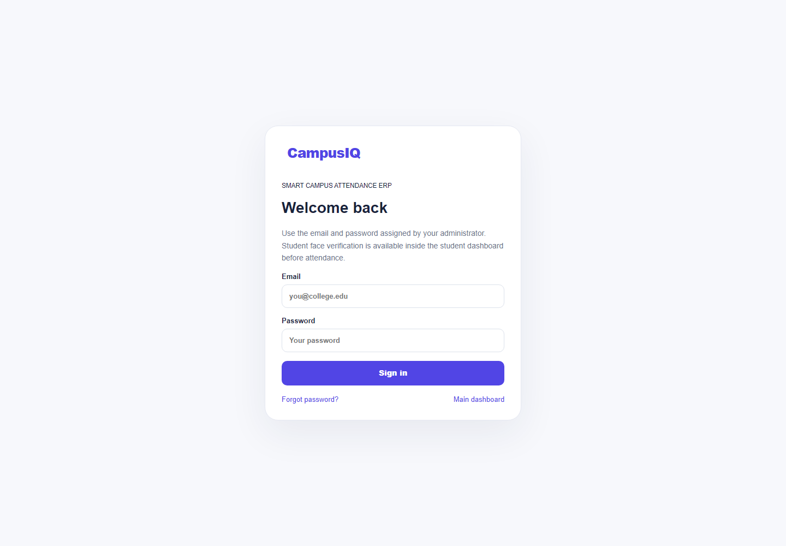
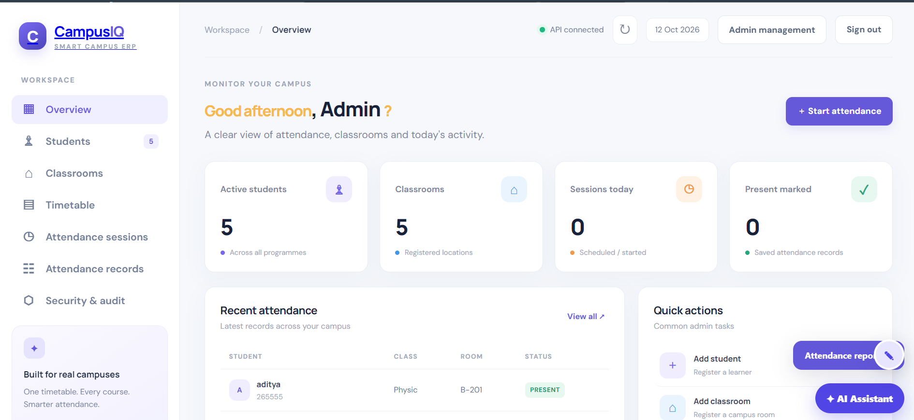

# CampusIQ — Smart Campus Attendance ERP (enhanced prototype)

Responsive web UI + Spring Boot REST API + H2/MySQL schema for multi-course college attendance. Includes course/section-aware timetable, classroom master, session tokens, attendance records, audit logs, password hashing, email-based password reset, basic per-IP request throttling, and configurable Tomcat connection/thread limits.

## Demo screenshots

| Sign in | Dashboard |
| --- | --- |
|  |  |

## Important status (read before official use)
This is an **enhanced development prototype**, not yet a production-secure biometric attendance system. Browser-based face descriptors are now enrolled and compared by the API, and a student face-attendance page is included. This is still a prototype: face descriptors arrive from the browser, short-lived in-memory face challenges/sessions are not durable, and robust liveness/anti-spoofing is not implemented. Also, login currently verifies credentials but does not yet issue a production access token or enforce authentication/roles across all ERP routes. Do not use this version for official attendance or expose it publicly until those security items are completed and tested.

## Requirements
- JDK 21+ (JDK 25 may work, but JDK 21 is the project's configured target)
- Maven 3.9+
- Default mode uses local H2; no separate database service required
- Optional MySQL 8+ and SMTP account for password reset

## Run on Windows
1. Extract the ZIP.
2. Open PowerShell in the folder containing `pom.xml`. Verify with `dir pom.xml`.
3. Run `java -version` and `mvn -version`.
4. Start the app: `mvn spring-boot:run`
5. Open `http://localhost:8081` for the sign-in page. After a successful staff sign-in, the admin dashboard opens; unauthenticated direct visits to the dashboard are redirected back to sign-in.

For the bootstrap administrator, set `BOOTSTRAP_ADMIN_EMAIL` and a strong `BOOTSTRAP_ADMIN_PASSWORD` (12–72 characters with uppercase, lowercase, a number, and a symbol) in the same PowerShell window before starting the app:

```powershell
$env:BOOTSTRAP_ADMIN_EMAIL = "admin@example.com"
$env:BOOTSTRAP_ADMIN_PASSWORD = "Replace-with-a-strong-password!"
mvn spring-boot:run
```

If the application was already running, restart it after changing these values. Student accounts continue to use the student login flow and can create their first password through Forgot password.

### Password reset OTP email

Forgot Password sends a one-time 6-digit OTP to the student's active, registered email address. Configure SMTP before starting the app. For Gmail, enable 2-Step Verification and create a 16-character App Password; do not use the normal Gmail password:

```powershell
$env:SMTP_HOST = "smtp.gmail.com"
$env:SMTP_PORT = "587"
$env:SMTP_USERNAME = "mishrasatyam08885@gmail.com"
$env:SMTP_PASSWORD = "your-gmail-app-password"
$env:SMTP_FROM = "mishrasatyam08885@gmail.com"
mvn spring-boot:run
```

After entering the registered student email, enter the OTP received in that inbox, then create a password with 10–72 characters including uppercase, lowercase, a number, and a symbol. These environment variables must be set again whenever a new PowerShell window is opened.

If PowerShell says there is no POM, you are in the wrong folder. Use `cd` into the inner `Smart-Campus-Attendance-ERP` folder where `pom.xml` exists. The default port is 8081. If port 8081 is occupied, stop the other app or set `$env:SERVER_PORT=8082` (then open port 8082).

## Open from your phone on the same Wi-Fi
1. Start the app on the PC.
2. Run `ipconfig` on Windows and note the PC's IPv4 address for the active Wi-Fi adapter (for example `192.168.1.20`).
3. Allow Java/Maven through Windows Defender Firewall for **Private networks only** or add an inbound TCP rule for port 8081.
4. On the phone connected to the same Wi-Fi, open `http://PC_IPV4_ADDRESS:8081`. Do not use `localhost` on the phone: it means the phone itself.
5. Public Wi-Fi/client isolation may block device-to-device connections. Do not port-forward this prototype to the public internet.

Face recognition scripts and model weights load from jsDelivr, so the first use needs internet access. Camera APIs on phones generally require HTTPS or localhost. Plain `http://192.168.x.x:8081` may not allow camera access in mobile browsers; use HTTPS for a real deployment.

## SMTP password reset
SMTP is intentionally disabled until configured. Never put real credentials in Git or share them in screenshots. For Gmail, enable 2-Step Verification and create a Google App Password; use that app password, not your normal Gmail password. Some college SMTP servers use different host/port/security settings.

In PowerShell, set these variables in the same terminal before starting the app (example only):

```powershell
$env:SMTP_HOST="smtp.gmail.com"
$env:SMTP_PORT="587"
$env:SMTP_USERNAME="your-sender@gmail.com"
$env:SMTP_PASSWORD="your-16-character-app-password"
$env:SMTP_FROM="your-sender@gmail.com"
mvn spring-boot:run
```

Pages and flow:
- `http://localhost:8081/login.html` — email/password login, then first-time face enrollment or repeat-login face verification
- `http://localhost:8081/student-dashboard.html` — student profile, database-backed attendance summary, recent attendance and face-enrollment status
- `http://localhost:8081/attendance.html` — choose an open session, enter its token, scan face and request attendance
- `http://localhost:8081/forgot-password.html` — request and verify the 6-digit reset OTP
- `http://localhost:8081/reset-password.html` — set and confirm a new password after OTP verification

Reset tokens are random, stored as SHA-256 hashes, expire after 15 minutes, and are invalidated after use. Passwords are hashed with BCrypt. Passwords must be 10–72 characters and contain uppercase, lowercase, a number, and a symbol. Basic in-memory rate limits apply per IP and reset when the app restarts; production should use a shared store (e.g. Redis) behind a trusted proxy.

**First-time student account setup:** add the student with a real, unique email address in the Students panel. Email is required because first-time password setup and recovery use OTP. The student then opens Forgot Password, verifies the emailed OTP, and sets a password. Seed/demo emails (for example, `aarav@example.edu`) are placeholders and cannot receive email; do not use them to test real SMTP. If a student sees “No student account was found”, check that the exact email is registered in the Students panel and that the backend is connected to the intended database.

## MySQL mode
1. Ensure MySQL is running and the database account has permission to create/use `smart_campus`.
2. In PowerShell: set `DB_URL`, `DB_USERNAME`, and `DB_PASSWORD` from `.env.example`.
3. Start with `mvn spring-boot:run "-Dspring-boot.run.profiles=mysql"`.
4. The schema file is `src/main/resources/schema-mysql.sql`.

## API overview
- `GET /api/health` — health check
- `GET /api/dashboard` — dashboard counters
- `GET|POST /api/students` — list/create students
- `GET|POST /api/classrooms` — list/create rooms
- `GET|POST /api/timetable` — timetable
- `POST /api/sessions/start` — start session and issue temporary token
- `GET /api/sessions` — list sessions
- `POST /api/sessions/{id}/close` — close session
- `POST /api/attendance/mark` — legacy prototype attendance endpoint
- `GET /api/face/status/{studentId}` — check face enrollment
- `POST /api/face/enroll` — store numeric face descriptor (raw image not saved)
- `POST /api/face/verify` — compare a live descriptor against the enrolled descriptor
- `POST /api/face/attendance` — verify face, session token and section before marking attendance
- `GET /api/attendance` — attendance register
- `GET /api/audit` — recent audit events
- `POST /api/auth/login` — check email/password
- `POST /api/auth/forgot-password` — email a reset token
- `POST /api/auth/reset-password` — consume token and update password

## Configurable connection limits
Defaults: max connections 200, accept queue 50, max request threads 100, min spare threads 10. Override with `SERVER_MAX_CONNECTIONS`, `SERVER_ACCEPT_COUNT`, `SERVER_MAX_THREADS`, `SERVER_MIN_THREADS`. These are server resource limits, not a guarantee that every client device can connect; Windows Firewall, Wi-Fi isolation, IP address, port availability, and browser camera security can still prevent access.

## Before production
- Add Spring Security with role-based route protection and secure access/refresh tokens; ensure every admin/teacher/student endpoint is authorized.
- Integrate a real face verification model and tested liveness/anti-spoofing service; never trust a client-sent `FACE_VERIFIED` flag.
- Add session-bound, signed QR challenges and robust replay prevention.
- Use HTTPS, secure cookies/token storage, CSRF protections as applicable, shared rate-limit storage, monitoring, backups and secret management.
- Add consent, retention/deletion controls, restricted biometric access, encrypted face templates and a manual appeal route. GPS cannot reliably distinguish adjacent indoor classrooms.
- Run automated tests, dependency scans, concurrency tests and real-device tests before college deployment.


## UI fix (October 2026)
- Fixed a JavaScript syntax error in CSV export (`join('\n')`) that prevented the main app script from loading; navigation, modal, search and action handlers were therefore not attaching.
- Added a visible Sign in / Sign out control to the dashboard. Successful student login now returns to the dashboard; sign out clears the browser-side student login state.
- The current `/api/auth/login` endpoint authenticates **student** accounts only. This is not yet secure administrator authentication, and the existing admin APIs are not protected by a server-side login session. Do not use this prototype for real campus records until role-based server-side authentication and API authorization are implemented.


## Password reset troubleshooting

Password reset sends an email only when SMTP is configured. Set `SMTP_HOST`, `SMTP_PORT`, `SMTP_USERNAME`, `SMTP_PASSWORD`, and `SMTP_FROM` in your environment, then restart the app. For local development only, set `RESET_TOKEN_EXPOSE=true` and restart; the Forgot Password page will display a one-time token for an active account so you can test the reset flow without email. Do not enable this on a public/shared server. Reset tokens expire after 15 minutes and are one-use.

## Face recognition troubleshooting

The browser loads face-api.js and its TinyFaceDetector, 68-point landmark, and face-recognition models from a CDN. The first face scan requires internet access; camera access requires `localhost` or HTTPS. If model loading fails, check browser DevTools Console/Network for CDN errors, allow camera access, and ensure only one face is in frame with good lighting. Enrollment/attendance uses three frames and averages their 128-value descriptors; the server compares the descriptor with the enrolled template. This is descriptor matching, not liveness detection, and must not be used for official attendance without anti-spoofing and security testing.


## Face attendance challenge (Step 2)

The attendance flow now requests a short-lived, student-bound face challenge after a face-verified session is confirmed. The attendance endpoint requires that challenge and consumes it after a successful attendance insert, reducing replay of a previously captured attendance request. Challenges are held in application memory and expire after five minutes; restarting the server invalidates them. This is not liveness detection and does not prevent camera/photo spoofing. Use HTTPS and perform a security review before real deployment.


## Step 3 — database-backed attendance reports
The database schema includes indexes for cohort/session/attendance joins. Attendance summaries are calculated from stored sessions and records, not browser-only state. Session creation now uses the database-generated primary key instead of querying `MAX(id)`, avoiding a concurrency race when two sessions start close together. The report endpoints are API-only in this step; role-based access control remains a required security task before deployment.


## Step 4 — student dashboard
- Added a responsive student portal with profile details, attendance percentage, present/eligible session totals, face-enrollment status, and recent attendance history.
- Successful face login now routes to the student dashboard; students can go to the attendance page from there.
- Added a student-scoped summary API. This remains a prototype: these endpoints still require server-side authentication and authorization before real deployment.


## Step 6 — Admin account management
- Open `/admin-management.html` to view student account status, activate/deactivate student accounts, add teachers to a directory, toggle teacher status, and review recent audit events.
- New teacher directory is persisted in the `teachers` table for H2 and MySQL.
- Account status changes are written to `audit_logs`. Existing attendance records are retained when an account is deactivated.
- **Security limitation:** the existing prototype does not yet have complete server-side admin/teacher role authentication. Do not expose the admin management page or APIs publicly until authentication/authorization is implemented.


## Step 7 — Staff role-based authentication

- Staff sign-in: `/staff-login.html`.
- Before first launch, configure `BOOTSTRAP_ADMIN_EMAIL` and `BOOTSTRAP_ADMIN_PASSWORD`. Use a unique 12+ character password with upper/lowercase, a number, and a symbol. Never commit credentials.
- Admins create teacher accounts in Admin Management and set an initial password; share it securely.
- Staff sessions use random bearer tokens stored server-side as SHA-256 hashes, expire after 8 hours, and can be revoked on logout.
- Admin APIs require ADMIN; teacher access is limited to timetable/session/attendance reads and session start/close.
- Prototype limitation: class ownership mapping and student self-service report authorization need a follow-up before public deployment.


## Step 8: Teacher-class assignment
Use **Account management → Teacher-class assignments** to assign timetable entries to active teachers. The backend filters teacher timetable/session/attendance reads and validates assignments for starting and closing sessions. See `STEP-8-TEACHER-CLASS-ASSIGNMENT.txt`.


## Step 9 — Student self-service authorization
- Student attendance history and summary endpoints require a valid face-verified bearer session.
- A student can only read the attendance data for the student ID bound to that session.
- Student open-session listing is restricted to the student's own course, branch, semester and section.
- Student sign-out revokes the in-memory session token.
- These face sessions are stored in application memory, so a server restart signs students out; use a persistent session store for multi-instance/production deployment.
- The face recognition demo still has no reliable liveness/anti-spoof detection and must not be treated as production-grade biometric security.


## Step 10 — Attendance Analytics
Open `http://localhost:8081/reports.html` after staff sign-in. Use date/course/branch/semester/section/subject filters, view subject percentages and low-attendance students, and export CSV. Teacher results are limited to assigned timetable entries. See `STEP-10-ATTENDANCE-ANALYTICS.txt`.

## Step 11 — Automated attendance notifications

The notification center creates an in-app alert when an active student falls below the configured attendance threshold (75% by default). A scheduled scan runs daily at 08:00 in Asia/Kolkata time; administrators can also trigger a scan from `/notification-center.html`. Students can view their own alerts at `/student-notifications.html` after face-verified login.

Optional email delivery uses the existing SMTP environment configuration: `SMTP_HOST`, `SMTP_PORT`, `SMTP_USERNAME`, `SMTP_PASSWORD`, and `SMTP_FROM`. Without SMTP, in-app notifications still work. Tune the threshold/schedule with `LOW_ATTENDANCE_THRESHOLD`, `ATTENDANCE_ALERT_CRON`, and `ATTENDANCE_ALERT_TIME_ZONE`. The database enforces one low-attendance alert per student per date. Review failed SMTP deliveries manually; automatic same-day retries are not implemented.

New APIs: `GET /api/notifications` (Admin), `POST /api/notifications/scan-low-attendance` (Admin), and `GET /api/student/notifications` (authenticated student, own alerts only). A full Maven build and real SMTP/database integration test remain pending in this environment.


## Step 12 — Excel and PDF report exports

The Reports page now offers CSV, Excel (.xlsx), and PDF exports using the same active filters. Teacher exports remain scoped to assigned timetable entries. Open `/reports.html` after staff login. See `STEP-12-EXCEL-PDF-EXPORTS.txt` for details.
